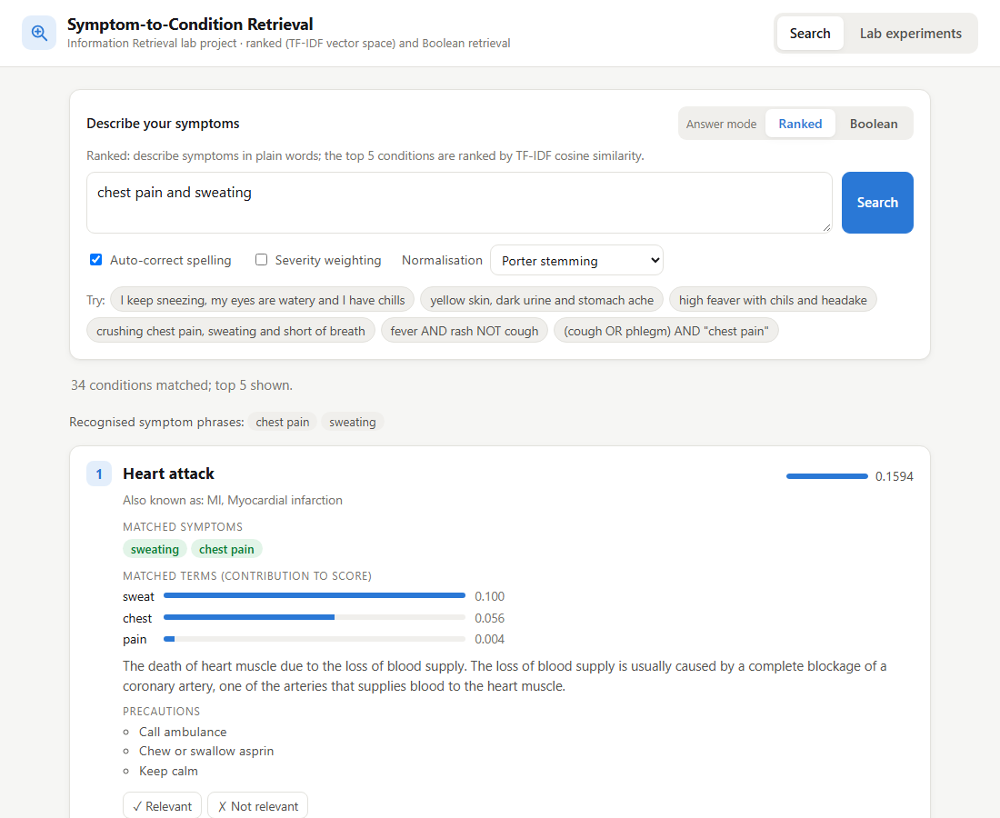
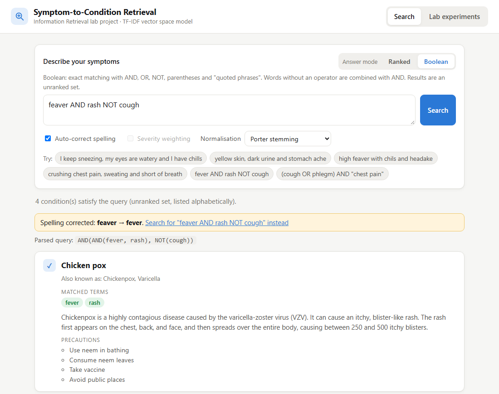
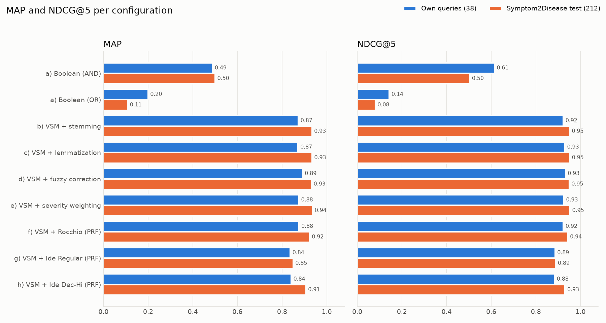
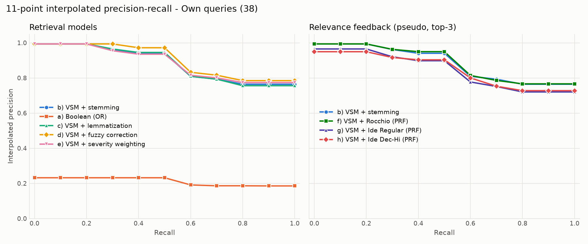

# Symptom-to-Condition Retrieval System

An information retrieval (IR) system that takes a description of symptoms in plain language
and returns the medical conditions that match it, with a short description and recommended
precautions for each. Every IR technique in the project is implemented from scratch in
Python: text preprocessing with a custom Porter stemmer, Boolean retrieval, the TF-IDF
vector space model, edit-distance spelling correction, relevance feedback, inverted-index /
suffix-array / suffix-trie indexing, and the evaluation metrics.

> **Disclaimer:** this is an academic IR project and not a medical diagnosis. Consult a
> doctor for health concerns. The system ranks documents; it does not assess anyone's health.



---

## Contents

- [Features](#features)
- [Quick start](#quick-start)
- [Answer modes](#answer-modes)
- [Command-line usage](#command-line-usage)
- [How it works](#how-it-works)
- [Project structure](#project-structure)
- [Evaluation](#evaluation)
- [Tests](#tests)
- [Data sources](#data-sources)

---

## Features

- **Two answer modes, chosen by the user:**
  - *Ranked*: plain-language search ranked by TF-IDF cosine similarity.
  - *Boolean*: exact matching with `AND`, `OR`, `NOT`, parentheses and quoted phrases.
- **Spelling correction:** misspelled symptoms are fixed with Levenshtein edit distance
  ("feaver" → fever, "headake" → headache). The web page shows a "Did you mean…" style
  notice with a link back to the original query.
- **Medical synonym map:** about 120 everyday phrases are mapped to dataset terms
  ("stomach ache" → abdominal pain, "throwing up" → vomiting).
- **Explainable ranking:** each result shows the matched symptoms and how much each term
  contributed to its score.
- **Relevance feedback:** mark results relevant or not relevant and re-rank with Rocchio,
  Ide Regular or Ide Dec-Hi.
- **Optional severity weighting:** symptom severity weights (1–7) boost serious symptoms
  such as chest pain or high fever.
- **Alternative disease names** from MedlinePlus, so "piles", "stomach flu" or
  "low blood sugar" find the right condition.
- **Lab page:** runs the preprocessing pipeline, pattern matching (wildcard, prefix, suffix,
  range, regex, fuzzy with the DP table) and the index-structure comparison on any input,
  and shows the saved evaluation results.
- **Web interface and command line**, both built on the same engine.
- **No IR or machine-learning libraries.** NLTK is used only for its stopword list, the
  WordNet lemmatizer and the POS tagger. The web server is Python's standard
  `http.server`.

---

## Quick start

Requirements: Python 3.10 or newer (developed and tested on Python 3.14).

```bash
git clone <this repository>
cd <repository folder>
pip install -r requirements.txt
python -c "import nltk; [nltk.download(p) for p in ['stopwords','wordnet','omw-1.4','averaged_perceptron_tagger_eng']]"
```

**Web version (localhost):**

```bash
python web/server.py            # open http://127.0.0.1:8000
python web/server.py --open     # also opens the browser
python web/server.py --port 9000
```

The server listens on `127.0.0.1` only. Stop it with Ctrl+C.

**Command line:**

```bash
python main.py                  # interactive search
python main.py --search "high fever with chills and a headache"
```

All data needed to run the system is included in `data/`. To download the external
datasets again, run `python download_data.py`.

---

## Answer modes

The mode is chosen for every search: with the switch above the search box on the web page,
or with the `[R]anked / [B]oolean` prompt in the interactive command line.

| | Ranked (default) | Boolean |
|---|---|---|
| Query | plain language: `I keep sneezing and my eyes are watery` | operators: `fever AND rash NOT cough`, `(cough OR phlegm) AND "chest pain"` |
| Model | TF-IDF vector space model, cosine similarity | term–document incidence matrix |
| Output | top 5 conditions with scores and a per-term score breakdown | every condition that satisfies the query, as an unranked set listed alphabetically |
| Options | severity weighting, relevance feedback | – |
| Best for | describing how you feel | precise questions, e.g. "fever and rash, but no cough" |



Boolean query rules:
- Operator precedence is `NOT` > `AND` > `OR`. Operators are case-insensitive.
- Words without an operator are combined with `AND`: `high fever` means `high AND fever`.
- `A NOT B` means `A AND NOT B`.
- A quoted phrase such as `"chest pain"` must appear as consecutive words. It is matched
  with the positional inverted index.

Spelling correction, the synonym map and stemming apply in both modes.

---

## Command-line usage

| Command | What it does |
|---|---|
| `python main.py` | Interactive loop: symptoms → spelling suggestions → answer mode → results → optional relevance feedback. Commands: `he*` or `suggest he` (symptom suggestions), `severity on/off`, `help`, `quit`. |
| `python main.py --search "QUERY" [--severity] [--method lemma]` | One-shot ranked search; spelling is corrected automatically |
| `python main.py --boolean "fever AND rash NOT cough"` | One-shot Boolean query, with the parsed query tree |
| `python main.py --preprocess "TEXT" [--method lemma]` | Every preprocessing step for a piece of text |
| `python main.py --tfidf "chest pain and sweating" [--severity]` | Query vector (df, idf, weights) and ranked results with the score breakdown |
| `python main.py --pattern "head*" [--pattern-type prefix\|suffix\|substring\|wildcard\|regex\|fuzzy\|exact]` | Pattern matching over the vocabulary |
| `python main.py --range fatigue fever` | Lexical range search |
| `python main.py --fuzzy feaver` | Edit-distance candidates and the full DP table |
| `python main.py --feedback "QUERY" --relevant 3 --nonrelevant 1 2 --feedback-method rocchio\|ide_regular\|ide_dec_hi` | Explicit relevance feedback, ranking before and after |
| `python main.py --index-compare [PATTERNS...]` | Substring lookup: inverted-index scan vs suffix array vs suffix trie (results and timing) |
| `python main.py --export-matrix incidence.csv` | Saves the term–document incidence matrix |
| `python main.py --evaluate` | Runs the full evaluation (same as `python eval/run_evaluation.py`) |
| `python main.py --no-external ...` | Any of the above using only the original Kaggle documents |
| `python -m pytest` | Runs the 84 unit tests |

Flags can be combined, e.g. `python main.py --boolean "fever AND rash" --fuzzy diarhea`.

---

## How it works

```
Offline:     data sources ──► cleaning ──► preprocessing ──► inverted index + TF-IDF vectors
Query time:  query ──► spelling correction ──► preprocessing ──► ranked (cosine) or Boolean
             ──► optional relevance feedback ──► results + precautions + disclaimer
```

### 1. Building the collection (`ir/data_loader.py`, `ir/external_data.py`)

The Kaggle dataset repeats each of its 41 diseases about 120 times, each time with a
random subset of the symptoms (4,920 rows). The cleaning step:

- **Merges the rows** so that each disease becomes one document containing the union of
  its symptoms: 41 documents with 4 to 17 symptoms each, 131 distinct symptoms.
- **Cleans symptom names:** `" skin_rash"` → `skin rash`, `"dischromic _patches"` →
  `dischromic patches`.
- **Normalizes disease names** across the files (trailing spaces, double spaces, case).
  One real misspelling (`hemmorhoids` / `hemorrhoids`) is joined by Levenshtein
  distance 2.
- **Fixes the severity table:** `foul_smell_ofurine` and `foul_smell_of urine` are
  matched with a space-free key, a duplicate entry keeps its maximum weight, and a
  non-symptom row is dropped.

Each document holds the disease name, its description and its symptoms. Two optional
sources then enrich it:

- **MedlinePlus "also called" names** (e.g. Hemorrhoids → *Piles*, Gastroenteritis →
  *Stomach flu*). Each disease is mapped by hand to one MedlinePlus topic. Diseases whose
  only match is a broader topic (e.g. Typhoid → "Salmonella Infections") get no names,
  because a broader topic's names are not synonyms.
- **Document expansion with Symptom2Disease:** the 851 descriptions in its training split,
  written by people in everyday words, are appended to the documents of the 22 diseases
  they describe. The test split is never used for building; train texts that also appear
  in the test split are removed.

### 2. Preprocessing (`ir/preprocessing.py`, `ir/porter_stemmer.py`)

The same pipeline is applied to documents and queries:

1. lowercase;
2. punctuation removal (punctuation becomes a space);
3. medical synonym mapping, longest phrase first, in a single pass;
4. tokenization;
5. stopword removal (NLTK English list plus query filler words and contractions);
6. **Porter stemming** (written from scratch; identical to NLTK's original-algorithm
   output on 28,409 test words) or **WordNet lemmatization**, selectable.

Noun groups ("high fever", "chest pain") are found with NLTK POS tags and the chunk
grammar `NG: {<JJ.*|VBN|VBG|NN.*>*<NN.*>}`.

### 3. Retrieval models

**Vector space model** (`ir/vector_space.py`):

- tf weight: `1 + log10(tf)`
- idf: `log10(N / df)`
- weight: `w(t,d) = tf weight × idf`
- score: `cos(q,d) = q·d / (|q| |d|)`

Only documents in the posting lists of the query terms are scored. Each result carries a
breakdown, `contribution(t) = q_t · d_t / (|q| |d|)`, and the contributions add up to the
score.

**Severity weighting** (optional): if the query mentions a known symptom, the query
weights of its terms are multiplied by `1 + λ · severity / 7`, with λ = 0.5. Whole
symptoms are detected first, so "back pain" (severity 3) does not inherit the weight of
"chest pain" (severity 7).

**Boolean model** (`ir/boolean_model.py`): a term–document incidence matrix and a
recursive-descent parser:

```
expr   := conj ( OR conj )*
conj   := factor ( [AND] factor | NOT factor )*
factor := NOT factor | '(' expr ')' | WORDS | "PHRASE"
```

`AND`, `OR` and `NOT` become element-wise `&`, `|` and `~` on the matrix rows.

### 4. Pattern matching and spelling correction (`ir/pattern_matching.py`)

- Exact, prefix, suffix and range queries use binary search on the sorted vocabulary.
  Suffix queries run as prefix queries on a reversed vocabulary.
- Wildcards are translated to regular expressions: `*` → `.*`, `?` → `.`, and `[abc]`
  is kept.
- Levenshtein distance: `D[i][j] = min(D[i-1][j]+1, D[i][j-1]+1, D[i-1][j-1]+[s_i≠t_j])`.
- An unknown word is corrected to the closest vocabulary word within 1 to 3 edits,
  depending on its length; ties go to the more frequent word.
- Words found in WordNet or the stopword list are never "corrected".

### 5. Relevance feedback (`ir/query_expansion.py`)

| Method | Formula |
|---|---|
| Rocchio | `q' = αq + β/|R| · Σ d_R − γ/|NR| · Σ d_NR` (α = 1, β = 0.75, γ = 0.15) |
| Ide Regular | `q' = q + Σ d_R − Σ d_NR` |
| Ide Dec-Hi | `q' = q + Σ d_R − d_top non-relevant` |

- All vectors are length-normalized first, and negative weights are set to 0.
- Pseudo-relevance feedback, used in the evaluation, assumes the top 3 results are
  relevant and ranks 11–20 non-relevant.

### 6. Indexing (`ir/indexing.py`)

- **Inverted index:** posting lists store doc ids, term frequencies and positions.
- **Suffix array** over `term1$term2$…$`: built by prefix doubling, with substring lookup
  by binary search (O(m log n)).
- **Generalized suffix trie:** substring lookup in O(m).

On the 1,329-word vocabulary, a substring lookup takes about 40 µs with a linear scan,
8 µs with the suffix array and 0.5 µs with the suffix trie. All three give identical
results.

### 7. Evaluation metrics (`ir/evaluation.py`)

- Precision, recall, F1, P@K and MRR.
- AP = (1/|Rel|) Σ P@k, and MAP is the mean AP over the queries.
- NDCG@K = DCG@K / IDCG@K, with DCG = Σ (2^g − 1) / log2(i + 1).
- 11-point interpolated precision–recall curves.

All metrics are written from scratch and tested against hand-computed examples.

---

## Project structure

```
data/
  archive/                    Kaggle CSV files (dataset, descriptions, precautions, severity)
  external/medlineplus/       medlineplus_subset.json (the 41 mapped topics)
  external/symptom2disease/   train.jsonl, test.jsonl, README.md
  processed_documents.csv     cleaned collection, one row per disease
ir/
  data_loader.py              dataset cleaning and document construction
  external_data.py            MedlinePlus names and Symptom2Disease document expansion
  preprocessing.py            preprocessing pipeline, synonym map, noun groups
  porter_stemmer.py           Porter stemmer
  boolean_model.py            incidence matrix and Boolean query parser
  vector_space.py             TF-IDF, cosine similarity, severity weighting
  pattern_matching.py         Levenshtein, fuzzy / wildcard / range search, suggestions
  query_expansion.py          Rocchio, Ide Regular, Ide Dec-Hi, pseudo-relevance feedback
  indexing.py                 inverted index, suffix array, suffix trie
  evaluation.py               evaluation metrics
  search_engine.py            ties the modules together for the CLI, web app and evaluation
eval/
  build_test_queries.py       builds test_queries.json (graded judgments)
  test_queries.json           38 test queries
  run_evaluation.py           compares all configurations, writes CSVs and charts
  results*.csv, severity_sweep.csv, *.png
web/
  server.py                   JSON API and static files (standard library only)
  static/                     index.html, style.css, app.js
tests/                        pytest unit tests
docs/                         screenshots used in this README
main.py                       command-line interface
download_data.py              downloads the external data again
```

---

## Evaluation

Run it with `python eval/run_evaluation.py`.

**Test collections**

| | Own queries (`eval/test_queries.json`) | Symptom2Disease test split |
|---|---|---|
| Queries | 38, written for this project; 4 contain deliberate misspellings | 212, written independently |
| Diseases covered | all 41 | 22 |
| Relevance | graded: 2 = intended condition; 1 = plausible related condition (shares at least 60% of the query's severity-weighted symptoms, or a hand-added relative); 0 = other | one correct condition per query |

**Effect of the data sources** (ranked mode, Porter stemming):

| Documents | P@1 (own) | MAP (own) | P@1 (Symptom2Disease) | MRR (Symptom2Disease) |
|---|---|---|---|---|
| Kaggle dataset only | 0.947 | 0.865 | 0.557 | 0.660 |
| + MedlinePlus names | 0.974 | 0.868 | 0.571 | 0.666 |
| + Symptom2Disease expansion | 0.974 | 0.868 | 0.873 | 0.933 |
| + both (final system) | **0.974** | **0.873** | **0.873** | **0.934** |

**Configurations** (final collection):

| Configuration | P@1 own | MAP own | NDCG@5 own | P@1 S2D | MRR S2D |
|---|---|---|---|---|---|
| Boolean (terms ANDed) | 0.684 | 0.488 | 0.615 | 0.486 | 0.500 |
| Boolean (terms ORed) | 0.105 | 0.200 | 0.143 | 0.000 | 0.108 |
| Ranked, Porter stemming | 0.974 | 0.873 | 0.923 | 0.873 | 0.934 |
| Ranked, WordNet lemmatization | 0.974 | 0.872 | 0.930 | 0.873 | 0.934 |
| Ranked + fuzzy spelling correction | 0.974 | 0.891 | 0.932 | 0.868 | 0.931 |
| Ranked + severity weighting | 0.974 | 0.875 | 0.925 | 0.877 | 0.936 |
| Ranked + Rocchio (pseudo feedback) | 0.974 | 0.876 | 0.923 | 0.859 | 0.923 |
| Ranked + Ide Regular (pseudo feedback) | 0.921 | 0.836 | 0.886 | 0.726 | 0.849 |
| Ranked + Ide Dec-Hi (pseudo feedback) | 0.921 | 0.841 | 0.883 | 0.830 | 0.907 |




**Observations**

- **Ranked retrieval suits plain-language input.** For the evaluation, each test query was
  turned into a Boolean query by joining its words with AND or with OR:
  - AND returned nothing for 11 of 38 own queries, because one extra word empties the
    result;
  - OR finds every relevant condition but cannot order them (P@1 0.105).

  Boolean mode is still useful for precise questions written with operators.
- **More data helped more than any algorithm.**
  - With the Kaggle data alone, the right condition was first for 95% of the own queries
    but only 56% of the independent ones.
  - Adding the Symptom2Disease training descriptions raised the independent result to 87%.
- **Fuzzy correction** raises MAP on the own queries (which contain typos) from 0.873 to
  0.891. The independent queries have few typos and change by less than 0.01.
- **Severity weighting** gives a small gain on both test sets. MAP rises from 0.873 to
  0.888 on the own queries and from 0.934 to 0.941 on Symptom2Disease as λ goes from 0
  to 2 (`eval/severity_sweep.csv`).
- **Pseudo-relevance feedback lowers the scores** on the expanded documents, because the
  expanded query drifts away from the original symptoms. Explicit feedback, where the user
  marks the results, is not affected.
- **Caveats.**
  - Symptom2Disease covers 22 of the 41 diseases.
  - Differences of about 0.01 come from one to three queries, so they are not
    statistically significant.

---

## Tests

```bash
python -m pytest
```

There are 84 tests:

- **Algorithms against hand-computed values:** edit distance and its DP table, cosine and
  TF-IDF, the Boolean parser and its evaluation on a 3-document collection, Rocchio /
  Ide Regular / Ide Dec-Hi, and every metric.
- **Porter stemmer:** agreement with NLTK's original algorithm.
- **Indexing:** the suffix array, suffix trie and vocabulary scan return the same results.
- **Data:** dataset cleaning, and the external data. The external-data tests include a
  check that no test text is used for document expansion.
- **Web API:** both answer modes and error handling.

---

## Data sources

| Dataset | Source | Used for |
|---|---|---|
| Disease Symptom Prediction | [Kaggle (itachi9604)](https://www.kaggle.com/datasets/itachi9604/disease-symptom-description-dataset) | main document collection (`data/archive/`) |
| Symptom2Disease | [gretelai/symptom_to_diagnosis on Hugging Face](https://huggingface.co/datasets/gretelai/symptom_to_diagnosis) (Apache-2.0) | document expansion (train split) and independent evaluation (test split) |
| MedlinePlus health topics | [U.S. National Library of Medicine](https://medlineplus.gov/xml.html) | alternative disease names. Information from MedlinePlus.gov. |

**References**

- C. D. Manning, P. Raghavan and H. Schütze, *Introduction to Information Retrieval*,
  Cambridge University Press, 2008.
- M. F. Porter, "An algorithm for suffix stripping", *Program* 14(3), 1980.
- J. J. Rocchio, "Relevance feedback in information retrieval", in *The SMART Retrieval
  System*, 1971.
- V. I. Levenshtein, "Binary codes capable of correcting deletions, insertions, and
  reversals", *Soviet Physics Doklady* 10(8), 1966.
- U. Manber and G. Myers, "Suffix arrays: a new method for on-line string searches",
  *SIAM Journal on Computing* 22(5), 1993.
- K. Järvelin and J. Kekäläinen, "Cumulated gain-based evaluation of IR techniques",
  *ACM TOIS* 20(4), 2002.
